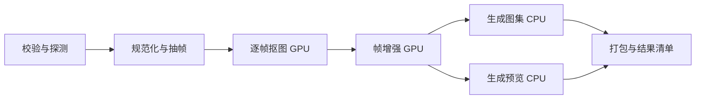

# 01 业务场景与需求

> 本文为设计阶段基线；实际实现与验证结果请参阅 [实现差异](09-实现差异与限制.md) 和 [验收记录](../evidence/acceptance.md)。

> 设计稿 v0.1；所有性能数字和实现范围均为计划，未经运行验证。

## 1. 题目理解

本题需要的是一个能够持续执行、解释自身状态、在故障后合理继续的 AI 任务管线。AI 算法是执行器的内容，调度与恢复是系统的主体。

评价时应能够回答：任务被接收后是否会丢？哪个步骤在等什么？一个步骤失败后是否浪费之前的计算？Worker 消失后谁来处理遗留任务？两次执行同时返回时哪个结果有效？运行一个小时后是否仍可查询、取消和恢复？GPU 被谁占用、为何排队、OOM 后如何处理？

因此，MVP 的成功标准是可复现地展示这些行为，而不是模型效果、动画质量、漂亮页面或组件数量。

## 2. 业务场景与角色

场景假设：动画素材平台需要把一段短动画转换为游戏或网页可用的透明帧、精灵图集和预览包。处理可能调用 GPU 模型，单次耗时从数十秒到数小时；素材编辑界面无法一直等待 HTTP 响应。

| 角色 | 核心需求 |
| --- | --- |
| 上游素材平台 / API 调用方 | 提交即返回 ID；稳定查询；重复请求不重复建任务；获取结果或明确错误 |
| 素材编辑者 | 看到步骤、进度及等待原因；失败后继续；已有产物能够复用 |
| 开发 / 运维人员 | 找到失败 Attempt、日志、Worker、资源占用；复现故障，说明恢复行为 |
| 执行 Worker | 领取可执行步骤；获得资源；持续上报；只提交仍然有效的结果 |

默认假设：单用户演示、单机部署、固定 DAG、一个 PostgreSQL、一个 Worker 服务；并发容量可配置，默认 CPU 槽 2、模拟 GPU 槽 1。支持用第二个 Worker 做并发争抢验证，不承诺集群调度能力。

素材默认使用仓库内可分发的预置样例，由服务端计算内容哈希。任意 URL 抓取、用户大文件上传、完整用户体系放到范围外，避免与管线主线争夺时间。

## 3. 一个任务如何流转

1. 用户选择预置素材、目标帧尺寸、模型版本、随机种子和演示故障方案。
2. 上游用幂等键提交。API 在事务中创建任务、固定 DAG 快照、步骤与接收事件，提交后返回 `202 + task_id`。
3. Worker 根据依赖挑选就绪步骤，先检查可复用产物，再领取 CPU / GPU 槽位执行。
4. 用户在页面或 API 中查看状态、排队原因、步骤进度、尝试时间线及资源情况。
5. 瞬时错误按步骤策略自动重试；不可恢复错误或预算耗尽后停止新步骤并收敛在途执行，任务进入失败。
6. 用户修复环境后恢复任务；校验并保留有效成功步骤，只重新执行未完成部分。
7. 所有必需步骤完成，产物清单提交成功后，任务成功。相同输入的新任务可以复用中间结果。

关掉页面不会取消任务；重启 API 不会中止 Worker；重启 Worker 后根据数据库继续执行。重启整个部署需要数据库卷和产物卷仍然存在。

## 4. 步骤与依赖定义

以 4 秒、24 FPS、约 96 帧的动画为说明样例。真实耗时由模型、设备与素材决定；MOCK 耗时独立配置。

| 步骤键 | 输入 | 输出契约 | 资源 | 独立恢复的价值 |
| --- | --- | --- | --- | --- |
| `inspect` | 素材内容及校验约束 | 格式、尺寸、帧数等元数据 | CPU | 早期拒绝无效任务；成本低，可整步重做 |
| `normalize_extract` | 素材及探测结果 | 有序帧清单、帧内容哈希、时间轴 | CPU | 与模型解耦，后续多模型可共用规范化结果 |
| `remove_background` | 规范化帧、模型配置 | 带透明通道的帧清单 | GPU | 昂贵且边界清晰，失败不应重新抽帧 |
| `enhance_frames` | 透明帧、目标尺寸、模型配置 | 增强帧清单 | GPU | 可独立重试和缓存；升级增强模型不必重跑抠图 |
| `build_atlas` | 增强帧、布局参数 | 图集、帧坐标与动画元数据 | CPU | 与预览相互独立，分支可并行 |
| `render_preview` | 增强帧、编码参数 | 预览文件及格式说明 | CPU | 编码失败不应重跑 GPU 推理 |
| `package` | 图集与预览产物 | 包文件及最终 manifest | CPU | 汇总完整性；两个分支完成后才允许执行 |

真实透明素材预览需要明确支持的编码格式；普通 MP4 的预览可以用棋盘背景合成，不承诺保留透明通道。P0 的模型计算及媒体生成均可用结构化 MOCK 产物，文件与页面必须标注 `simulated=true`。

StepSpec 固定包含：步骤键、处理器及版本、直接依赖、参数映射、输入输出 schema 版本、资源需求、超时、重试策略、缓存策略、是否支持检查点。执行期间不修改 DAG；修改参数或模型版本创建新任务。

依赖规则：只有所有直接父步骤均为 `SUCCEEDED` 或 `CACHED`，且产物通过验证，子步骤才可就绪。P0 所有步骤都必需，不支持条件分支、可选失败、动态扩图、循环或人工审批节点。

## 5. 需求与优先级

P0 是提交前必须形成闭环的范围；P1 是在核心验证完成后选择性增加；P2 只给演进方向。

| ID | 优先级 | 需求 | 可验收行为 |
| --- | --- | --- | --- |
| R01 | P0 | 异步提交与请求幂等 | 重复幂等键和相同请求返回同一任务；不同请求体冲突返回 409 |
| R02 | P0 | 固定 DAG 执行 | 依赖未满足不执行；两个分支汇合后才打包 |
| R03 | P0 | 状态和历史持久化 | 重启后可查询每个步骤及历次 Attempt |
| R04 | P0 | 步骤级自动重试 | 瞬时错误退避，成功上游不增加 Attempt |
| R05 | P0 | 失联检测与自动接续 | 租约过期后旧 Attempt 标 LOST，新 Attempt 接续；失效写入被拒绝 |
| R06 | P0 | 人工恢复失败任务 | 新恢复代次保留有效成功步骤；错误历史不被清空 |
| R07 | P0 | 结果复用与完整性 | 同键命中有效产物；版本、参数或内容变化不能误命中 |
| R08 | P0 | 查询 API 与轻量看板 | 列表、DAG、尝试、错误、等待原因、产物可查看 |
| R09 | P0 | 超时与取消 | 运行超时形成明确 Attempt；取消后不再启动新步骤 |
| R10 | P0 | 模拟 GPU 调度及遥测 | 同一模拟槽不重复分配；显示排队与模拟指标来源 |
| R11 | P0 | 故障注入与演示记录 | 固定场景重复运行；自动重试、杀 Worker、缓存损坏均有证据 |
| R12 | P0 | 可复现交付 | 公开仓库、启动说明、环境配置、验证记录及简要说明 |
| R13 | P1 | 步骤内分块检查点 | MOCK 已提交分块可恢复；真实模型另行验证 |
| R14 | P1 | 真实 GPU 适配 | GPU UUID 绑定、NVML 采样、进程清理及真实 OOM 验证 |
| R15 | P1 | SSE、标准监控导出或公网演示 | 按实际剩余时间选择，不能阻塞核心交付 |
| R16 | P2 | 多机、租户、公平调度与外部模型服务 | 另行设计，不计为 MVP 已实现能力 |

## 6. 非功能要求与明确边界

- **正确性**：不丢已提交任务；同一 Step 只有一个有效的当前 Attempt；重复计算可能发生，失效结果不能成为正式产物。
- **响应性**：API 只处理短事务。热缓存且数据库健康的本地演示中，计划让提交响应小于 1 秒，不含文件上传；不是已测性能承诺。
- **观测延迟**：页面默认 2 秒轮询，Worker 调度/恢复扫描默认 1 秒；状态延迟目标 5 秒内，故障检测另受租约影响。
- **恢复时限**：Worker 容器恢复、数据库和卷健康且资源可安全回收时，目标在租约过期后 5 秒内安排重试；资源隔离或退避会延后开始。
- **保留策略**：P0 演示期间不自动删除被任务引用的产物或执行历史，提供磁盘容量提示；长期清理单独设计。
- **持久化故障范围**：覆盖应用/Worker/容器中断，不承诺宿主磁盘损坏、数据库永久丢失或跨地域灾备。
- **上游契约**：以查询为主，不承诺 webhook 恰好送达；日志和 trace 不能替代持久业务状态。

MVP 不承诺 exactly-once 计算、任意 GPU 内核断点恢复、多机 GPU 抢占、动态图编排、高可用数据库或真实模型效果评测。

## 7. 当前采用的假设

目前未给出硬性截止时间、部署机器、GPU 条件和个人技术偏好。文档采用“单人约 20 小时开发预算、优先公开仓库、本机可运行 Linux 容器、无真实 GPU 也能演示”的设计基线；这是规划假设，不是用户已承诺投入的时间。

若后续发现只能原生 Windows 运行、可用时间明显更短或必须调用真实模型，应先调整验收范围和执行器边界，再进入实现。业务 DAG、状态语义与持久化原则可以保留。
