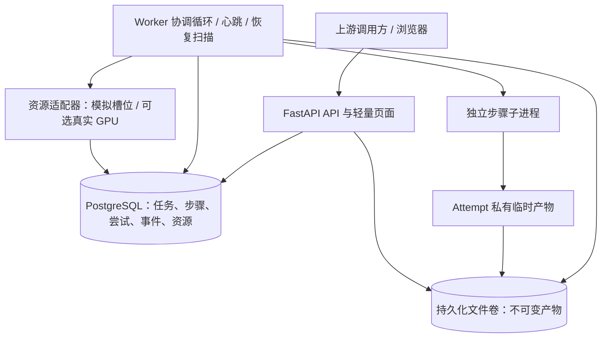

# 02 架构与技术选型

> 本文为设计阶段基线；实际实现与验证结果请参阅 [实现差异](09-实现差异与限制.md) 和 [验收记录](../evidence/acceptance.md)。

## 1. 架构结论

选择“API + PostgreSQL + 单机 Worker + 持久化文件卷”。Worker 自带小型协调循环和恢复扫描器，固定 DAG 由服务端注册。业务执行与 HTTP 请求生命周期分离。

这个选择用数据库事务统一解决任务接收、状态更新和历史记录，把复杂度集中在少数可验证的状态转换中。代价是需要自己实现并验证租约、重试和产物提交；这些正是本题需要展示的能力。

API 和 Worker 复用领域模型与持久化层，分别作为不同服务启动。API 不启动执行线程，也不在进程启动钩子里顺带运行调度器，避免多 API 副本产生隐式重复调度。

默认部署为 3 个 Compose 服务：`api`、`worker`、`postgres`。数据库独立卷，API/Worker 共享产物卷；Worker 对产物卷可写，API 下载路径只读。默认不安装 Redis、MinIO 或外部监控服务。

## 2. 技术栈

以下是建议基线，不表示已安装或已经锁定依赖。实现时固定兼容版本和锁文件，不使用浮动 `latest` 镜像。

| 层 | 选择 | 与题目的关系 | 代价和限制 |
| --- | --- | --- | --- |
| 语言 | Python 3.12 | 与 AI/媒体生态一致，子进程与 MOCK 易于实现 | CPU 密集工作不能阻塞协调循环 |
| API / 参数校验 | FastAPI、Pydantic 2、Uvicorn | 异步接收、类型契约、OpenAPI 查询与联调 | `async` 本身不提供持久化或恢复 |
| 数据库 | PostgreSQL 16 | 状态、队列、历史、资源共用短事务和约束 | 需管理连接、迁移、持久卷与查询索引 |
| 数据访问 | SQLAlchemy 2、psycopg 3、Alembic | 事务边界明确、表模型与迁移可审查 | ORM 不能掩盖 CAS 条件和锁顺序 |
| 执行 | 独立 Worker + 子进程 | 进程中断可检测，计算不会卡住 API | 子进程生命周期与清理必须验证 |
| 页面 | Jinja2、原生 JS、SVG/CSS | 列表、固定 DAG、时间线和轮询，少一套构建链 | 不做复杂编辑器或大规模实时图 |
| 文件 | 本地持久卷 + SHA-256 清单 | 中间产物耐进程重启，可验证和复用 | 多机前必须改为共享存储或对象存储 |
| 可观测性 | DB 事件、结构化 JSON 日志、查询 API | 无额外服务就能回答执行过程与错误 | P0 不提供跨服务 trace 后端或长期指标系统 |
| GPU | P0 模拟适配器；P1 NVIDIA NVML | 无卡也可验证排队、绑定、错误与遥测字段 | 模拟数据不证明真实 GPU 隔离与性能 |
| 验证 | pytest、HTTP 测试客户端、真实 PostgreSQL 集成测试 | 验证故障后状态与结果，避免 SQLite 模拟锁语义 | 故障验证比普通 CRUD 测试更费时间 |
| 打包 | Docker Compose；文档说明 Windows Docker Desktop/WSL2 前提 | 单命令复现 Linux 执行边界 | 原生 Windows 的进程树回收需另行适配 |

FastAPI 官方将轻量请求后工作与重型后台计算作了区分。本方案据此选择独立执行进程；持久化及恢复由本项目协议提供，不由 `BackgroundTasks` 提供。[FastAPI Background Tasks](https://fastapi.tiangolo.com/tutorial/background-tasks/)

PostgreSQL 官方明确说明 `SKIP LOCKED` 可以服务于多消费者的队列表，同时不适合作为一般查询的一致性手段。本项目只在领取候选任务时使用，状态判断仍靠事务内重验。[PostgreSQL 16 SELECT](https://www.postgresql.org/docs/16/sql-select.html)

## 3. 一次任务的完整调用链

1. API 校验输入及服务端固定 DAG，生成规范化请求指纹；同一事务创建 Task、Steps、依赖和 `TASK_ACCEPTED` 事件。
2. 数据库提交后返回 `202`。若响应途中断，上游用同一幂等键重发即可查到原任务。
3. Worker 周期扫描依赖可满足的步骤，先验证输入与已有产物，命中缓存则在短事务内标记 `CACHED`。
4. 未命中时，在同一短事务中重验 Task/Step、占用资源、生成 Attempt、增加 fencing token、设置租约，提交后才启动计算。
5. 子进程只接收输入引用、参数和 Attempt 私有目录，向父进程报告进度。正式状态与产物索引只由 Worker 按令牌提交。
6. Worker 定期续约并更新进度；恢复扫描器处理过期租约、到期重试、任务截止时间与取消请求。
7. 子进程结束后，Worker 校验文件、发布不可变文件，最后用条件事务确认 Attempt 仍有效，提交步骤成功、产物元数据及事件。
8. 下游就绪；最终必需产物全部有效后，任务成功。API 查询始终从数据库读取状态，不读取 Worker 内存来推断业务结果。

文件发布与数据库成功提交并非同一原子事务，具体崩溃窗口见 [03](03-执行状态与恢复设计.md)。不能仅凭文件出现就认为步骤成功。

## 4. 关键架构决策

### ADR-01：PostgreSQL 同时承担持久化就绪队列

决策：数据库保存 `READY`、`RETRY_WAIT`、租约和调度时间；Worker 每秒扫描。任务创建后无需再投递另一份消息，因此没有“数据库已经提交但队列消息丢失”的双写窗口。

代价：轮询有有限延迟；需要索引和空闲退避；状态转换热点可能限制吞吐。MVP 只承诺小规模单机任务。未来加通知或消息队列时，以 DB 状态为准；若确有对外事件投递，再设计 outbox 和消费幂等。

### ADR-02：短事务与长执行分开

决策：数据库行锁只覆盖领取、续期、提交、失效与恢复等短操作。AI 计算、文件哈希和文件传输均放在事务外，必要时事务内再检查版本。

数据库锁的生命周期由事务控制，不能把长任务的所有权等同于持有一把小时级行锁。[PostgreSQL 显式锁](https://www.postgresql.org/docs/16/explicit-locking.html)

代价：释放行锁后需要持久租约和令牌阻止旧执行者写回；这是正确性必需机制。

### ADR-03：固定 DAG，不实现通用工作流引擎

决策：服务端注册一个带版本的动画管线；任务创建时保存完整快照及其哈希，校验重复键、缺失依赖、环与必需输出。开发者通过新增版本更改流程。

代价：不能在线拖拽编辑任意流程。收益是失败语义、缓存影响范围与恢复路径可以完整解释。

### ADR-04：轻量页面，查询接口先行

决策：同源 HTML 页面以 2 秒间隔查询任务快照，事件用每任务游标增量拉取。服务端模板和少量 JS 足以呈现固定 DAG 与时间线。

代价：实时性不如推送，复杂交互能力有限。若浏览器断线，重连后重新拉快照和事件即可，执行不受影响。SSE 属于可选增强，不要求 P0 实现。

### ADR-05：本地不可变产物先满足单机恢复

决策：文件保存在持久卷，路径按执行 Attempt 或内容指纹隔离，数据库保存正式引用。P0 不启用自动 GC，不覆盖旧产物。

代价：不能直接扩成多机 Worker；容器临时目录不能充当产物存储；卷被手工删除后无法靠 DB 恢复文件。扩展时替换 ArtifactStore，保留相同提交协议。

## 5. 替代方案与切换条件

以下为针对本项目范围的工程判断，不是产品优劣排名。

| 方案 | 适用条件 | 本次取舍 |
| --- | --- | --- |
| SQLite + 单 Worker | 完全单进程串行、最快本地原型、明确限制并发 | 可行，但 API/Worker 分进程、资源领取与并发验证更适合直接使用 PostgreSQL |
| Redis + Celery / RQ | 团队已有设施和经验，需要成熟任务投递与多进程消费 | 本题还需定义 DAG、产物复用、业务历史和恢复语义；额外引入一套状态源暂不划算 |
| Temporal / 其他持久工作流引擎 | 工作流多样、复杂长时间交互、团队已有部署与运维经验 | 可减少部分自研执行控制，但需要学习和部署；固定 DAG 的本轮不采用 |
| React / Vue SPA | 复杂图编辑、多人协作、丰富交互，已有前端资产 | 当前固定 DAG 和看板不需要额外前端构建工程；可在后续替换 UI |
| Kubernetes + GPU Operator | 多节点、租户配额、设备发现与运维体系已经存在 | 超出“无需完整分布式调度系统”的边界；本轮做单机资源槽位即可 |

若实际开发者对现成持久工作流引擎非常熟悉，应重新比较总实现时间，而不是坚持自研。当前选择的依据是固定业务范围和可解释性。

## 6. 容错与部署边界

| 故障 | 设计行为 |
| --- | --- |
| 浏览器关闭 | 后端继续；重新打开可恢复查询 |
| API 重启 | Worker 继续；短期无法查询，恢复后读 DB |
| 步骤子进程退出 | Worker 记录失败并执行重试策略 |
| 整个 Worker 容器被终止 | 无续租；恢复后扫描租约；持久卷与 DB 必须保留 |
| 只杀协调进程但遗留子进程 | 拒绝失效写入；资源隔离，不能仅因租约过期便假定旧进程已消失 |
| 数据库短暂不可用 | API 返回可识别错误；Worker 停止领取，不能续租时停止提交并尝试停止本地执行 |
| 宿主掉电 | 重启后按 DB/产物卷恢复；文件耐久依赖实际落盘协议，不能把进程崩溃验证当掉电验证 |
| DB 或产物卷永久丢失 | 超出 MVP 恢复范围，需备份和灾备体系 |

Worker 的协调/心跳路径不能执行重型计算，子进程输出通道也不能无限积压。子进程 API 可参考 Python 的 `spawn` 语义；当前 Linux 容器执行契约与原生 Windows 进程树回收需要分开验证。[Python 3.12 multiprocessing](https://docs.python.org/3.12/library/multiprocessing.html)

## 7. 预计工程结构

本节为未来实现建议，当前不创建这些源码文件。

| 目录 | 内容 |
| --- | --- |
| `app/api` | 提交、查询、恢复、取消与产物访问 |
| `app/domain` | 状态、错误分类、DAG、重试和缓存策略 |
| `app/persistence` | 表模型、事务仓储、条件更新和锁协议 |
| `app/worker` | 领取、心跳、恢复扫描、执行监督与资源管理 |
| `app/pipelines` | 固定动画流程和处理器注册 |
| `app/artifacts` | 文件存储、manifest、校验与发布 |
| `app/templates`、`app/static` | 看板和轮询交互 |
| `tests/integration` | 真实数据库和进程故障验证 |
| `docs` | 设计、验收证据和交付记录 |

## 8. 可观测性取舍

P0 优先做持久业务事件、关联日志、快照和资源采样，完整回答单任务的“在哪、为什么、花多久、试几次”。状态变更事件与状态更新在一个数据库事务内提交；普通日志写失败不能改变业务结果。

OpenTelemetry 将 traces、metrics、logs 作为不同信号。本项目后续可为每次 Attempt 建短 span，以 `task_id/step_id/attempt_id` 关联；小时级执行不必保留一个始终打开的巨型 span。[OpenTelemetry Signals](https://opentelemetry.io/docs/concepts/signals/)

外部监控导出仅是增强。数据库保存的执行历史才是恢复依据，不能依赖可能被采样、丢弃或过期的 trace。
