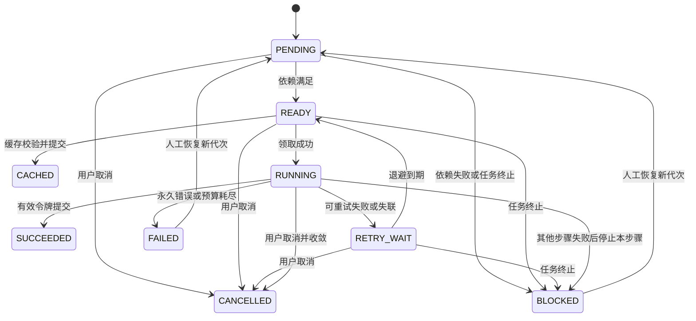

# 03 执行状态与恢复设计

> 本文为设计阶段基线；实际实现与验证结果请参阅 [实现差异](09-实现差异与限制.md) 和 [验收记录](../evidence/acceptance.md)。

## 1. 执行语义与不变量

系统提供**至少一次计算尝试 + 受条件保护的结果提交**。进程在“计算完成、状态尚未提交”之间消失时，计算可能重复；不承诺 exactly-once 计算，也不对任意外部副作用承诺恰好一次。

核心不变量：

1. API 返回接收成功之前，Task、固定 DAG、Steps 和接收事件已经提交。
2. Step 同时只有一个 `current_attempt_id`，每次领取递增 `fence_token`；旧令牌不能提交、续期或修改进度。
3. Step 成功必须存在已验证、已发布且有正式元数据的产物；发现临时文件不代表成功。
4. 下游只消费直接依赖的正式产物，不读取父步骤工作目录。
5. 状态转换、Attempt 结束、产物关联和业务事件在同一 DB 事务提交；失败不能只写日志。
6. 失联表示“当前授权已过期”，不表示旧计算物理上已停止。GPU 重新分配还需确认旧进程已结束。
7. 成功、缓存命中、失败、失联和取消都有可追溯来源；人工恢复不能删除原历史。

## 2. 三层状态与恢复代次

**Task** 表示一次固定输入与固定流程的业务请求。**Step** 表示 DAG 中的逻辑节点。**Attempt** 表示某一步的一次实际执行。

Task 有 `execution_epoch`：首次为 1，人工恢复时加 1。自动重试和失联接续属于同一代次。Attempts 记录代次，历史 Step 产物可以来自更早代次；输入和 DAG 不变。

不额外增加一套 Job/Run 调度实体。每次人工恢复由事件记录原因、操作请求及前后代次；Attempt 与事件足以展示执行历史。未来需要计费或多个独立运行视图时再引入 TaskRun。

### 2.1 Task 状态

| 状态 | 含义 | 合法后继 |
| --- | --- | --- |
| `QUEUED` | 当前代次已接收，还未取得执行进展，可能等待 Worker 或资源 | RUNNING、CANCELLING、FAILED |
| `RUNNING` | 当前代次正在推进；也可能退避、等待资源或收敛故障 | SUCCEEDED、FAILED、CANCELLING |
| `CANCELLING` | 用户取消已持久化，停止新领取，正在收敛在途执行 | CANCELLED |
| `SUCCEEDED` | 所有必需步骤完成，最终结果引用已提交 | 无 |
| `FAILED` | 不可重试、预算耗尽或截止；在途执行已失效并处理完 | QUEUED，仅显式人工恢复 |
| `CANCELLED` | 用户取消完成，在途授权已撤销 | 无，重新执行需创建新 Task |

等待原因通过 `wait_reason` 表示，例如 `NO_WORKER`、`GPU_BUSY`、`RETRY_BACKOFF`、`RESOURCE_QUARANTINED`、`CLEANUP_PENDING`。任务不需要为每种原因增加一个顶层状态。

`RUNNING` 不等于持续占有 GPU。任务可以等待退避；页面必须展示原因和下一次计划时间。

### 2.2 Step 状态

| 状态 | 含义 |
| --- | --- |
| `PENDING` | 父依赖尚未满足 |
| `READY` | 依赖满足，等待容量或调度 |
| `RUNNING` | 存在有效当前 Attempt，包括启动、计算与提交阶段 |
| `RETRY_WAIT` | 前一次尝试结束，等待 `next_run_at` |
| `SUCCEEDED` | 本 Step 实际执行产生有效产物 |
| `CACHED` | 复用其他 Step 的有效产物，没有本次计算 Attempt |
| `FAILED` | 当前代次该 Step 终止失败 |
| `BLOCKED` | 依赖失败或任务停止导致本代次无法继续，须有原因 |
| `CANCELLED` | 用户取消导致未完成步骤终止 |

上图省略了初始根节点直接就绪，以及完整性异常后的显式失效流程。`SUCCEEDED/CACHED` 不因普通重试回退；仅在人工恢复校验失败时，记录失效事件并使该节点及所有后代返回 `PENDING`。已成功 Task 的历史状态不被后台悄悄改写；下载时发现文件缺失则报告产物不可用，修复执行创建新 Task。

### 2.3 Attempt 状态

`RUNNING → SUCCEEDED / FAILED / TIMED_OUT / LOST / CANCELLED`。

终态不再更改，迟到成功不能把 `LOST` 覆盖掉。`phase` 可取 `STARTING/EXECUTING/FINALIZING`；开始占槽即创建 Attempt，进程未能启动也有记录。资源未获得、缓存命中不创建计算 Attempt。

Step 每次领取都会生成新 Attempt；`attempt_no` 在 Step 生命周期内单调递增。重试预算按 `execution_epoch` 统计，默认每步最多 3 次尝试，包含第一次、超时和失联；资源等待和缓存命中不消耗次数。

## 3. 领取协议与事务锁

默认隔离级别为 READ COMMITTED，靠显式锁、唯一约束与条件更新完成关键判断。

统一锁顺序：**Task → Steps（稳定键顺序）→ 已有 Attempts → ResourceSlots（稳定 ID 顺序）**。心跳、领取、完成、取消和恢复都遵守；不允许先锁资源再回头锁任务。扫描可先无锁读取候选，进入事务后必须重验。

领取过程：

1. 无锁查找 `READY` 或已到期 `RETRY_WAIT` 候选，按创建时间和步骤键排序。
2. 短事务中以 `FOR UPDATE SKIP LOCKED` 取得对应 Task；再锁目标 Step。重验代次、状态、依赖、停止标记、截止时间、当前 Attempt 和重试次数。
3. 若有有效缓存候选，先在事务外做文件验证，事务内重验元数据版本并提交 `CACHED`、产物引用和事件。缓存命中也可使 Task 从 QUEUED 进入 RUNNING。
4. 未命中则查找本 Worker 可用的资源槽，锁住并分配。不满足时保持 READY，记录等待原因；不创建 Attempt。
5. 递增 Step 的 token，创建 Attempt，设置 Worker 所有者、租约、资源持有者、Task RUNNING 及领取事件；提交事务。
6. 事务提交后再启动子进程；启动失败按同一个 Attempt 记录失败，不能假装没发生过。

候选查询顺序只提供近似 FIFO；有锁竞争时不保证严格全局先后。没有拿到资源的候选不能阻塞后面的可执行 CPU 步骤。

## 4. 心跳、超时和失联

| 参数 | P0 建议默认值 | 作用 |
| --- | --- | --- |
| 调度 / 恢复扫描 | 1 秒 | 发现就绪、退避到期与租约过期 |
| Attempt 心跳 | 5 秒 | 延长当前授权；由独立协调路径执行 |
| Attempt 租约 | 30 秒 | 判断授权是否过期，与计算时长无关 |
| 子进程启动超时 | 30 秒 | 避免领取后一直没有进程开始 |
| Step 运行超时 | 按步骤配置，演示 60～300 秒 | 限制单次实际执行时长 |
| Task 当前代次截止时间 | 默认 30 分钟，可配置 | 限制本代次排队、退避和执行总时间 |
| 无进展告警 | 如 60 秒，仅提示 | 区分仍活着但无进展，不能通用判定死亡 |

所有持久调度时刻使用 DB UTC 时间；API 输出 ISO 8601。协调进程内经过时长用单调时钟，重启后以持久截止时间重新判断。长任务只需提高业务超时，不应把 30 秒租约延成一小时。

续租必须同时满足：Task 仍允许执行、epoch 一致、Step RUNNING、Attempt 是 current、token/owner 一致、旧租约仍未到期。已过期租约不可“迟到续活”。进度更新使用同样授权条件。

心跳证明 Worker 的控制路径还活着，不证明模型正在推进。Supervisor 需要独立检查进程退出、运行超时、取消请求与输出协议；业务进度另存 `last_progress_at`。

数据库断连时，Worker 不领取新步骤、不假设续租成功。接近本地估算的租约安全边界时停止本地执行；若停止失败，保留隔离状态。重连后不能直接把旧进程计算结果提交为成功。

## 5. 失联接管与旧执行者隔离

恢复扫描器发现租约过期后，在短事务中重验当前 Attempt 与租约：

1. 原 Attempt 置 `LOST`，记录检测时间与错误；清除 current 指向或使令牌失效。
2. 若 Task 仍允许执行且预算可重试，Step 进入 RETRY_WAIT；否则按取消、任务停止或预算耗尽分别进入 CANCELLED、BLOCKED 或 FAILED，绝不在取消后再排重试。
3. 原资源槽进入 `QUARANTINED`，等待进程清理确认，不能仅因租约过期改为 AVAILABLE。
4. 记录 `ATTEMPT_LOST` 与恢复计划。到期后只能在安全可用资源上创建新 Attempt。

新 Attempt 使用更大的 token。假设 A(token=4) 失联，B(token=5) 接管，A 再回报成功：检查 token/current/lease 失败，返回拒绝并记录迟到回报；A 的私有文件成为孤立文件，不改变 Step、缓存索引或正式产物。

令牌只保护本系统控制的数据。调用有计费或不可逆副作用的外部服务时，必须使用对方支持的幂等请求键、持久请求 ID 或对账机制，不能把本地 token 当作外部 exactly-once 保证。

P0 的主要故障演示边界是整个 Worker 容器被终止后重启，确认旧容器进程已结束再解除隔离。仅杀 Supervisor 而遗留子进程、节点失联或真实 GPU 未释放时，优先保持隔离并显示人工处理原因，不能宣称总能无人工自动恢复。

## 6. 重试、人工恢复和失败收敛

### 6.1 分类重试

| 错误类别 | 行为 |
| --- | --- |
| 临时网络故障、可识别暂时资源错误、MOCK 瞬时错误 | 自动退避重试 |
| 输入不合法、格式不支持、模型配置缺失 | 立即失败；修正业务输入应新建 Task |
| 进程退出、超时、Worker 失联 | 记录独立 Attempt 终态，预算允许则重试 |
| GPU OOM | 原配置下默认终止，避免稳定 OOM 无效重试；见 06 |
| 产物缺失 / 哈希不符 | 拒绝消费和缓存命中，记录完整性问题；按失效范围恢复 |
| 无法确认副作用的外部超时 | 标记结果不确定，禁止无脑重试；P0 不接此类服务 |

默认最多 3 次 Attempt，退避 `min(2 × 2^(n-1), 30)` 秒并加 0～20% 抖动；`n` 为刚失败的本代次尝试序号。重试时间持久化为 `next_run_at`，Worker 重启不重新计时，不占用睡眠线程或 GPU 槽。

OOM 后自动减小 batch、换分辨率或模型会改变执行配置，必须形成可审计配置和不同缓存身份。P0 不做静默降配。

### 6.2 终止失败的收敛

出现不可重试错误或预算耗尽时，设置 Task `stop_reason=STEP_FAILED`，停止领取新步骤。失败节点保持 FAILED，依赖节点记 BLOCKED；独立但未开始的分支也标 BLOCKED，注明 TASK_ABORTED。

正在执行的兄弟分支收到停止请求；若已先提交成功则保留成功，否则撤销授权，Attempt CANCELLED、Step BLOCKED。必须在所有在途授权失效、进程停止或被安全隔离后，再将 Task 记 FAILED。收敛期间 Task 仍 RUNNING，页面显示失败原因和 CLEANUP_PENDING，不能继续启动新工作。

这样人工恢复时既能保留已经成功的独立分支，也不会出现“Task FAILED，但还有授权有效的后台计算在继续”的矛盾。

### 6.3 人工恢复

只允许恢复 FAILED Task。操作在任务锁内校验没有有效在途 Attempt，增加 execution_epoch，记录恢复操作和原因；每次恢复请求需要操作幂等键，默认最多人工恢复 5 次。

恢复同时清除停止原因与本代次完成时间，将 epoch_started_at 设为当前 DB 时间，按原任务冻结的时长预算重新计算 deadline_at；自动重试和 Worker 重启绝不延长该截止时间。原代次的截止、失败及完成时间保存在事件中，任务从首次提交起的总耗时仍可查询。

恢复前验证已有成功/缓存产物。有效的步骤保留；失败、阻塞以及产物无效节点和全部后代进入 PENDING，再按依赖推进。旧 Attempts 和事件不删除，重试预算在新代次重新计算。任务输入和流程快照不变。

若执行中的任务在消费父产物时发现文件缺失或损坏，先记录 ARTIFACT_INVALID 并停止/收敛任务，不继续消费或静默修改父节点的成功历史；人工恢复时再显式使无效节点及后代失效。新任务查到坏缓存则按缓存未命中处理，这两种场景要区分。

若存在多个失败根节点，任务级恢复统一继续所有未完成部分。步骤级人工重试按钮仅作为“单个失败根节点”的快捷入口，多根失败返回 409 并提示使用任务级恢复；自动重试始终按 Step 独立执行。

## 7. 产物提交与崩溃窗口

产物协议采用“先发布不可变文件，再提交数据库引用”，不尝试构建 DB 与文件系统的分布式事务。

1. 子进程只写 `work/{task}/{step}/{attempt}/` 私有目录，不覆盖其他 Attempt 文件。
2. 计算完成后生成 manifest：schema、文件列表、大小、内容哈希、语义配置指纹及模拟标记。
3. Worker 校验完整性。P0 文件小，采用完整 SHA-256 校验；大文件哈希成本属于后续优化。
4. 在同一文件系统发布到带 Attempt ID 的唯一不可变位置，使用完成标记及原子重命名策略。需要掉电耐久时还必须验证文件/目录同步落盘和具体文件系统语义，不能仅依赖 rename。
5. 短事务内锁 Task/Step/Attempt，检查 epoch、current、token、owner、状态和未过期租约；检查 Task 未取消/停止且未超时。
6. 在同一事务写 Artifact 元数据、Step 输出关联、Attempt SUCCEEDED、Step SUCCEEDED、可用缓存项和事件。数据库拒绝时文件不得成为正式结果。

| 崩溃位置 | 恢复结果 |
| --- | --- |
| 临时文件尚未写完 | 没有正式引用；原 Attempt 失联，整步重试 |
| 文件写完，尚未发布 | 仍是临时文件；不复用，之后可清理 |
| 已发布文件，DB 尚未成功提交 | 孤立不可变文件；P0 不自动认领，重新计算可能发生 |
| DB 已提交成功，Worker 未收到确认 | 重读 DB；若本 Attempt 已成功则幂等返回，不新建冲突产物 |
| Step 成功，调度器尚未推进下游 | 后续扫描根据持久依赖继续，不能依赖一次内存回调 |
| DB 成功后文件被删除 | 查询报告不可用；消费/复用时必须校验，不能假成功 |

完成请求重发时，若数据库显示该 Attempt 已用相同 manifest 成功提交，返回原结果；不同 manifest 或失效 Attempt 返回冲突。文件和记录均不可由迟到回报覆盖。

P0 不自动做孤立文件清理，避免 GC 与提交竞争。后续 GC 需只删除无正式引用、无有效 Attempt 且超过安全保留期的文件，并再次检查引用。

## 8. 缓存与结果复用

复用分两类：同任务恢复保留有效成功 Step；新任务通过内容与配置指纹复用其他任务产物。`CACHED` 是成功的满足方式，不伪造一个计算 Attempt。

缓存键使用规范化数据构造 SHA-256，至少包含：

- 处理器 ID、处理器版本、输入/输出 schema 版本及缓存键 schema 版本；
- 语义相关参数，包括尺寸、阈值、随机种子、编码配置；
- 直接输入的内容哈希与输入端口名，帧顺序不可丢失；
- 模型/权重标识及摘要、影响结果的运行环境兼容版本；
- `simulated` 执行模式。MOCK 与真实模型绝不能共用缓存。

不把 task_id、展示名称、调度时间、退避策略或故障注入计划放入语义键。DAG 总版本不必使所有步骤缓存失效；每个步骤键覆盖所有影响本步结果的定义，任务仍保存完整流程版本便于解释。

每步只映射其声明使用的参数，不能把整个 Task 参数对象不加区分地加入每个步骤键；否则只改预览编码参数也会错误地让抽帧和抠图缓存失效。帧顺序、时间轴与颜色空间等输入语义同样必须进入对应输入指纹。

命中条件：缓存项有效、来源成功提交、输入/参数身份匹配、manifest schema 兼容、全部文件存在且校验通过。缓存无效时先标无效并记录原因，再按未命中执行。

同键并发 MISS 允许重复计算，避免额外的缓存锁协议；缓存索引唯一约束选择首个有效提交作为候选，另一份成功产物仍可由其 Task 引用。若原缓存已被标无效，允许条件替换索引。P0 不把“减少重复计算”升级成 exactly-once 承诺。

上游输入变化会经内容哈希自然影响后代。只改 `render_preview` 编码参数应仅使预览与打包重算，图集仍可复用；修改增强模型则影响增强及其后代，抠图和抽帧仍可复用。

## 9. 取消与超时的竞争

取消命令先锁 Task，把状态置 CANCELLING 并记录事件；之后领取必须失败。未开始步骤置 CANCELLED，在途执行请求停止；租约被撤销后完成提交失败。确认进程停止或隔离后 Task CANCELLED。

若最后成功事务先获得任务锁并提交，Task 已 SUCCEEDED，之后取消返回 409；若取消先提交，之后成功不能提交。Task 截止时间导致 FAILED，Step 运行超时产生 TIMED_OUT Attempt；两者错误码必须区分。

被终止的线程、子进程或 GPU 内核未必能立即响应取消。P0 承诺取消意图和授权撤销可观测，不能承诺真实 GPU 的毫秒级抢占。

## 10. 步骤内部恢复边界

P0 保证恢复到步骤边界：已完成步骤复用，失败或中断的当前步骤从头重做。页面中的 `50%` 是观测信息，不是一个可恢复检查点。

P1 才扩展帧/分块级检查点，保存已完成分块的实际产物、版本、哈希、分块身份及提交记录。恢复必须验证后再跳过；仅记录一个 frame_index 或把进度写入数据库不足以正确续跑。真实模型包含时序状态、随机数状态或训练优化器时，还需专门设计相应检查点。
