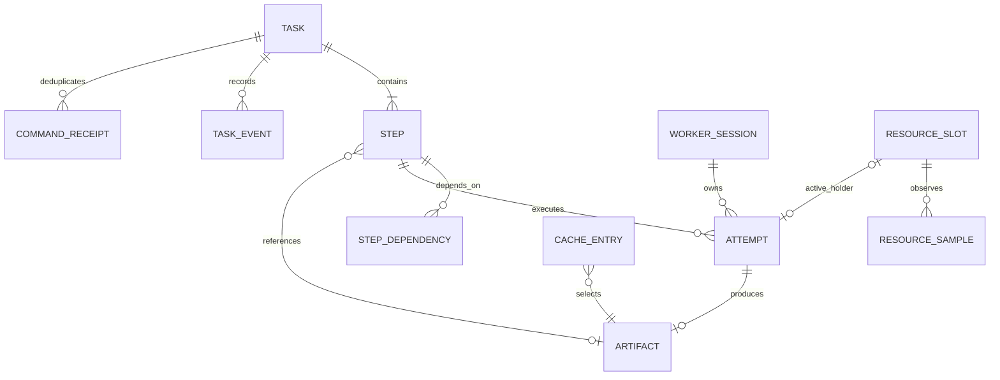

# 04 数据模型与接口

> 本文为设计阶段基线；实际实现与验证结果请参阅 [实现差异](09-实现差异与限制.md) 和 [验收记录](../evidence/acceptance.md)。

> 本文描述数据契约，不包含建表或接口实现。状态语义以 [03](03-执行状态与恢复设计.md) 为准。

## 1. 实体关系

`ARTIFACT` 表示一个带 manifest 的产物集合，里面可以有多张帧图片；不为每个文件建一张调度实体。Step 只有一个主输出集合，具体端口映射位于 manifest 中。

缓存命中时 Step 直接引用来源 Artifact，Artifact 的 producer 仍指向原 Attempt。关系图为概念模型，实际采用 `steps.output_artifact_id` 实现引用，而非必须创建通用多对多表。

## 2. 持久化实体与原因

### 2.1 `tasks`

| 字段组 | 关键字段 | 持久化原因 |
| --- | --- | --- |
| 身份与请求 | id、caller_scope、idempotency_key、request_hash | 接收幂等，重发不创建重复任务 |
| 不可变业务定义 | input_snapshot、input_digest、parameters、pipeline_id/version/snapshot/hash | 重启后知道到底执行什么，避免新代码改写旧任务语义 |
| 当前控制状态 | status、execution_epoch、revision、stop_reason、cancel_requested_at、wait_reason | 控制执行、人工恢复与并发命令 |
| 时间 | created_at、epoch_started_at、finished_at、deadline_at、epoch_timeout_seconds | 总耗时与当前代次预算；人工恢复重置本代次截止，重启不重置 |
| 历史游标与结果 | event_seq、final_artifact_id、summary_error | 一致快照、上游结果与错误摘要 |

P0 用固定 caller_scope 也保留幂等作用域字段，不把全局字符串当成未来所有用户共享的幂等空间。输入摘要由服务端确认，不能盲信调用者提供的哈希。

### 2.2 `steps`

`id/task_id/step_key`、StepSpec 快照、status、state_revision、current_attempt_id、fence_token、next_run_at、wait_reason、output_artifact_id、cache_key、cache_source_step_id、progress_done/total/unit、last_progress_at、summary_error。

每个 Step 的处理器版本、参数、超时、重试、资源需求和缓存策略从流程快照派生并冻结。当前视图便于查询，不能只靠重放日志推导全部状态。

`progress_done/total` 是当前 Attempt 的观测值，重试可能归零；`output_artifact_id` 才决定已完成工作能否复用。

### 2.3 `step_dependencies`

`task_id/parent_step_id/child_step_id/input_port`。父子必须属于同一 Task。唯一约束防重复边；无自环、所有引用存在、全图无环在任务创建前校验。

把依赖显式保存，是为了重启后按同一图推进，并能解释 BLOCKED 的原因。P0 不接受客户端任意提交 DAG。

### 2.4 `step_attempts`

| 类别 | 字段 |
| --- | --- |
| 身份 | id、step_id、attempt_no、execution_epoch、fence_token |
| 所有权 | worker_session_id、lease_expires_at、heartbeat_at |
| 状态与阶段 | status、phase、exit_code、error_code/class、retryable、error_summary |
| 时间 | claimed_at、execution_started_at、finished_at、run_deadline_at |
| 执行环境 | effective_config_digest、runtime_version、resource_slot_id、simulated |
| 观测与控制 | progress_snapshot、log_ref、executor_control_ref、cleanup_state |

`cleanup_state` 表示进程停止是否已确认，如 `PENDING/CONFIRMED/QUARANTINED`；不等同于 Attempt 业务终态。`executor_control_ref` 是可信控制信息，不允许根据用户传入 PID 杀进程。

错误摘要限制长度且脱敏，完整堆栈写关联日志。所有失败 Attempt 保留，重试成功不能覆盖它们。

### 2.5 `task_events`

`task_id/seq/event_id/event_type/execution_epoch/step_id/attempt_id/occurred_at/from_state/to_state/reason/payload`。

状态转换、失联、缓存命中/失效、恢复和取消等关键事件与业务状态在同一事务写入。每个 Task 的 `seq` 在锁住 Task 行后递增，所有事件写入遵守该规则，保证每任务提交顺序可用作游标。

不能直接用全局自增 ID 作为可靠事件提交游标：并发事务可能先分配 ID 后提交，读者前进后会漏掉晚提交的小 ID。P0 只提供按任务的有序事件查询，不提供跨任务全局事件流。

心跳和每帧进度不生成完整事件洪流，保存最新快照即可。关键里程碑可按阈值采样为事件，页面时间线不等同于逐帧日志。

### 2.6 `artifacts` 与 `cache_entries`

Artifact：id、producer_attempt_id、manifest_uri、manifest_digest、schema_version、content_digest、size_bytes、simulated、availability、created_at。路径是受控相对存储键，不暴露宿主绝对路径。

CacheEntry：cache_key、artifact_id、source_step_id、valid、invalid_reason、validated_at、revision。缓存身份与产物身份分开，文件被标损坏时可以让缓存索引失效，同时保留执行历史。

跨 Task 复用通过 Step 引用已有 Artifact，不能把文件复制完就伪造“本次执行成功”。来源和节约的执行次数要可查。

### 2.7 `worker_sessions`、`resource_slots` 与 `resource_samples`

- WorkerSession：会话 UUID、稳定 node_id、boot/session 标识、能力、最后心跳、软件版本、模拟标记。重启创建新会话，不接续旧会话身份。
- ResourceSlot：node_id、resource_type、device_uuid、容量声明、状态、holder_attempt_id、holder_fence、quarantine_reason。CPU 槽和 GPU 槽采用统一的占用记录。
- ResourceSample：slot/device、采样时间、来源 `mock/nvml`、利用率、显存、温度、有效性及不可用原因；用于资源页面与故障分析。

物理设备字段只在真实适配器中有意义；MOCK 的 8 GiB 等容量是演示配置。采样失败记录不可用，不能填成 0 假装设备空闲。

P0 样本量小，保留演示记录；长期部署再设定降采样和保留期，不能把高频采样永远写入业务表而不限制容量。

### 2.8 `command_receipts`

记录恢复、取消等控制命令的 `task_id/action/operation_key/request_hash/response_snapshot/created_at`。同事务写命令收据和状态变更，保证客户端超时重发不会把 epoch 增加两次。

## 3. 必要约束和索引

| 约束 / 索引 | 防止的问题 |
| --- | --- |
| UNIQUE(tasks.caller_scope, idempotency_key) | 并发提交重复任务 |
| UNIQUE(steps.task_id, step_key) | 同图重复节点 |
| UNIQUE(attempts.step_id, attempt_no) | 尝试序号冲突 |
| 每 Step 至多一个 RUNNING Attempt 的部分唯一约束 | 应用代码错误导致双当前尝试 |
| Step current_attempt 与 Attempt 所属关系校验 | 指向其他步骤的执行 |
| UNIQUE(task_events.task_id, seq) | 每任务事件重复游标 |
| UNIQUE(command_receipts.task_id, action, operation_key) | 重复控制操作 |
| UNIQUE(cache_entries.cache_key) | 同键索引竞争；允许多个真实产物 |
| UNIQUE(resource_slots.node_id, resource_type, device_uuid/slot_key) | 重复注册同一资源槽 |
| 资源持有者与 Attempt 关系约束 | 一个槽分配多个当前持有者 |
| Steps(status, next_run_at) 与 Attempts(status, lease_expires_at) | 就绪/过期扫描不全表遍历 |
| Tasks(created_at, id)、Events(task_id, seq)、Attempts(step_id, attempt_no) | 稳定列表分页与时间线查询 |

跨行不变量不能全部只靠 CHECK 表达，需事务锁与条件更新共同保证。集成验证必须使用 PostgreSQL；不能在 SQLite 测试通过后宣称并发锁协议正确。

## 4. 不持久化或不作为恢复依据的内容

不持久化活的 Python 对象、线程句柄、数据库连接、GPU 上下文、Future、内存队列。它们重启后不可直接复用。

进程控制引用可以持久化供清理，但不能让一个旧 PID 自动恢复执行。GPU 利用率是采样观测值，不是排他调度锁。进度百分比、日志和 trace 都不能替代检查点或正式产物。

原始大文件不写数据库，不把一帧对应一条状态事件作为默认设计。数据库保存元数据与索引，文件卷保存实际内容。

## 5. API 契约

所有路径为计划；HTTP 响应基于已提交状态。业务 ID 使用不可预测的 ID；公开部署时读写鉴权见 05。默认同源页面无需跨域开放。

| 方法与路径 | 语义与关键返回 |
| --- | --- |
| `POST /api/tasks` | `Idempotency-Key` 必填；预置素材 ID、参数、管线版本；新建 202，返回 task_id、状态、查询 URL |
| `GET /api/tasks?status=&cursor=&limit=` | 按 created_at/id 稳定分页；不支持无界返回 |
| `GET /api/tasks/{id}` | 同一读快照的任务、步骤、依赖、进度、wait_reason、revision、event_cursor、结果可用性 |
| `GET /api/tasks/{id}/steps/{key}/attempts` | 所有代次的尝试历史、错误、运行时间、资源与日志引用 |
| `GET /api/tasks/{id}/events?after_seq=&limit=` | 仅此 Task，返回有序事件与 next_cursor |
| `POST /api/tasks/{id}/resume` | FAILED 且无有效在途 Attempt；操作幂等键、期望 revision、原因；202 或明确冲突 |
| `POST /api/tasks/{id}/steps/{key}/retry` | 单失败根节点的人工恢复快捷入口，语义同 resume；多根失败返回 409 |
| `POST /api/tasks/{id}/cancel` | 接受取消意图返回 202；终态不可取消；重复相同操作幂等 |
| `GET /api/tasks/{id}/artifacts` | 正式产物清单、来源、校验与模拟标记 |
| `GET /api/artifacts/{id}/files/{file_key}` | 仅允许 manifest 中登记文件；不存在或损坏返回可识别错误 |
| `GET /api/resources` | Worker、槽位、持有者、等待任务与最新采样及新鲜度 |
| `GET /api/overview` | 成功/失败/重试/缓存统计、运行时长与资源排队概况 |
| `GET /health/live`、`GET /health/ready` | 进程存活与 DB/必要存储可用；Worker 不在线另作业务状态提示 |

查询参数 limit 有上限；错误结构包含 code、message、retryable、request_id，以及允许公开的 task/step/attempt 引用。输入校验失败使用 422，身份/权限错误使用 401/403，状态冲突 409，未知 ID 404，DB 暂时不可用 503。

幂等处理：相同 key + 相同 request_hash 返回原 Task，不创建新 Task；相同 key + 不同语义请求返回 409。正文中的展示名称与故障控制字段如何进入 request_hash 必须冻结：**提交请求指纹覆盖整个规范化业务与演示请求，缓存键只覆盖结果语义**，两者不能混用。

恢复/取消支持期望 revision，以避免旧页面针对已经变化的状态发命令。合法自动心跳不会频繁改变命令 revision；只有控制/状态变更递增，减少无意义冲突。

## 6. 查询一致性与轮询

详情接口使用一次短的只读一致快照（如 REPEATABLE READ），返回 Task 状态、所有 Steps 和该快照的 `event_cursor`。不能由若干不一致的独立查询拼出“Task 已成功但步骤仍在执行”的视图。

页面首次读取快照，再从游标向后查询事件。断线后重新读取完整快照即可恢复；重复事件按 event_id 去重。P0 不设置事件自动过期；若未来归档需提供游标失效响应和重新取快照的流程。

页面状态每 2 秒刷新；终态降低或停止轮询，后台标签页延长间隔，断线展示“数据更新时间”并退避。一次请求未结束不叠加下一次轮询，禁止无限并发积累。

## 7. 看板最小信息结构

| 页面 | 必需信息 | 必需操作 |
| --- | --- | --- |
| 任务列表 | 状态、素材、已完成步骤数、创建时间、最后更新、等待/失败原因 | 新建演示任务、按状态筛选、进入详情 |
| 任务详情 | 固定 DAG、节点状态、依赖、当前阶段、产物来源 | 取消、合法时恢复、查看结果 |
| 步骤抽屉 / 区域 | Attempt 1/2/3、代次、错误、起止、退避、token、资源、日志 | 查看失败原因与历史，单根失败重试 |
| 时间线 | 接收、领取、失败、重试、失联、复用、取消与完成 | 按步骤或 Attempt 过滤 |
| 资源区 | Worker 新鲜度、槽位状态、占用者、等待原因、模拟/真实标记 | 跳转持有任务与排队任务 |

进度优先显示“已完成 4/7 步，当前处理 48/96 帧”，而不是把步骤数量冒充准确时间百分比。没有可靠进度时展示“运行中，已耗时…，最近心跳…”。本次 Attempt 重试时明确提示进度可能归零。

## 8. 可观测字段与统计口径

日志关联字段：request_id、task_id、execution_epoch、step_key、attempt_id、worker_session_id、fence_token、resource_slot_id、event_type、error_code、duration_ms、simulated。

| 指标 | 口径 |
| --- | --- |
| 任务端到端耗时 | 初次接收到最终结束，人工恢复间隔计入；当前代次耗时另列 |
| 步骤排队耗时 | 依赖满足到领取，区分资源等待与退避 |
| Attempt 运行耗时 | execution_started_at 到结束；启动和提交耗时可另分 |
| 恢复发现延迟 | LOST 检测时间减租约过期时间 |
| 恢复开始延迟 | 新 Attempt 开始减旧租约过期，包含退避和资源隔离 |
| 重试次数 / 错误分布 | 按 Attempt 和错误码统计，不按最终 Task 状态掩盖失败 |
| 缓存命中率 | 有资格查缓存的 Step 中 CACHED 次数占比；同任务保留另计 |
| GPU 占槽时长 | 逻辑分配到释放；不是内核实际计算时长 |
| GPU 利用率 / 显存 | 设备采样，带 measured_at/source；不是天然精确的每任务归因 |

任务 ID 等高基数字段适合日志与查询；若 P1 增加 Prometheus，不把它们直接当指标 label。细粒度状态历史必须保留在 DB，而非依赖外部图表。
