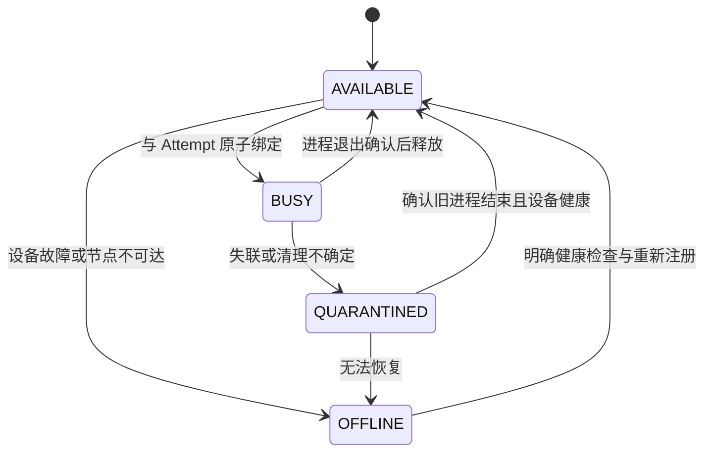

# 06 GPU 调度与小时级任务

> 本文为设计阶段基线；实际实现与验证结果请参阅 [实现差异](09-实现差异与限制.md) 和 [验收记录](../evidence/acceptance.md)。

R14 后续已实现可选 NVIDIA CUDA 探针并进行 RTX 4060 硬件验证；当前实现、WSL 采样限制和实际证据见 [GPU 实现说明](11-真实GPU实现与验收.md) 与 [硬件验收](../evidence/gpu-acceptance.md)。本文其余内容保留原设计背景。

## 1. GPU 范围与实现分层

P0 实现真正的资源占用状态机、排队、绑定、隔离与查询，但资源设备和利用率由 MOCK 提供。没有真实 GPU 的环境也能复现“GPU 忙、任务排队、模拟 OOM、Worker 失联”的控制行为。

P1 才接真实 NVIDIA GPU，使用相同资源接口替换发现、采样、绑定与清理适配器。若未实际运行真卡，交付说明必须写明“设计覆盖，尚未硬件验证”，不能把模拟显存曲线当成真实 GPU 证据。

| 能力 | P0 MOCK | P1 真 GPU |
| --- | --- | --- |
| 设备身份 | `mock-gpu-0` 等稳定槽位 | node_id + GPU UUID，必要时包含 MIG 身份 |
| 容量 | 固定模拟容量 | NVML 发现的设备与能力 |
| 占用 | DB 中原子独占槽位 | DB 独占 + 设备绑定 + 可信进程生命周期 |
| 遥测 | 可复现模拟曲线，source=mock | NVML 采样，source=nvml，带有效性与时间 |
| OOM | 结构化注入错误 | CUDA/模型适配器识别真实 OOM，保留日志 |
| 回收 | 确认 MOCK 执行器退出后释放 | 确认真实进程停止并检查设备情况，异常时隔离 |

## 2. 资源请求与准入

每个 Step 声明资源类型、数量和约束。P0 CPU 步骤请求 1 个 CPU 槽，GPU 步骤请求 1 个 GPU 槽；Worker 还有一个全局并发上限，控制内存与子进程数。

GPU 资源声明可包含 `gpu_count=1`、`min_vram_mb`、所需能力标签、预期显存和执行超时。P0 只支持一任务独占整卡，不实现多卡协同、显存切片、MPS、抢占或自动扩容。

准入流程：

1. 只考虑本 Worker 所在 node 的设备；单机文件卷不支持跨机调度。
2. 校验设备类型、最低容量、健康与采样新鲜度。
3. 依照 03 的锁顺序，在领取事务中将 AVAILABLE 槽绑定给新 Attempt 和对应 fence。
4. 没有设备时 Step 保持 READY，显示 GPU_BUSY/NO_MATCHING_GPU；不消耗 Attempt，不把业务标失败。
5. 资源获得后才开始该 Attempt 的启动/执行超时，Task 当前代次截止时间仍包含资源等待。

调度按近似 FIFO，CPU 与 GPU 候选分别扫描，避免等待 GPU 的节点堵住所有 CPU 工作。P0 不承诺多租户公平性和严格 FIFO；排队位置是估算，主要提供等待原因和等待时长。

## 3. 真 GPU 的绑定与隔离

用 GPU UUID 做稳定身份，在子进程初始化 CUDA 之前设置 `CUDA_VISIBLE_DEVICES`。CUDA 官方说明该变量控制设备可见性和枚举顺序；被绑定物理 GPU 可能在进程内成为 `cuda:0`，需要同时记录物理 UUID 和进程内序号。[CUDA 环境变量](https://docs.nvidia.com/cuda/cuda-programming-guide/05-appendices/environment-variables.html)

可见性配置本身不是显存硬配额，也不能阻止其他应用使用该卡。单卡独占仅在本系统管理的任务之间成立。真实部署需要专用设备或额外设备隔离；容器 GPU 访问配置与主机驱动也必须实际验证。

NVML 观测到的剩余显存只能辅助准入，存在采样延迟和外部进程竞争，不能把 `free_memory > request` 当作原子显存预留。MVP 宁可整卡独占，减少共享显存碎片和并发 OOM 的解释成本。

## 4. 资源状态和回收协议

资源持有者与 Step/Attempt 状态一并更新。正常计算退出且进程已确认结束后可释放；令牌失效或取消时不能先释放再等待停止进程。

假设 A 在 GPU 上计算，心跳丢失后 DB 将 A 标 LOST。A 的 CUDA 内核可能仍在运行，因此不能直接把同卡分配给 B。该卡进入 QUARANTINED；节点恢复后，由可信执行监督器核对会话和执行控制身份，确认旧执行器结束，再解除隔离。

P0 主要验证“终止整个 Worker 容器再重启”，使旧执行进程范围明确。仅协调进程退出、宿主失联或无法证明旧进程停止时，保留隔离并显示 `RESOURCE_CLEANUP_REQUIRED`。不会提供一个无条件把槽位改回 AVAILABLE 的普通用户按钮。

如果新 Attempt 能在同机其他健康设备运行，可以继续，但旧槽仍隔离。跨节点接管需要共享存储和节点管理，不计为本轮能力。

## 5. GPU 可观测性

NVIDIA NVML 提供设备状态、利用率、显存、温度、功耗与进程等查询能力，是后续真卡采样的首选接口。[NVML API Reference](https://docs.nvidia.com/deploy/nvml-api/latest/index.html)

`nvidia-smi` 适合人工诊断；其官方文档提示输出格式不保证向后兼容，因此程序化长期采样优先使用 NVML 接口，而不是解析人类可读表格。[nvidia-smi 文档](https://docs.nvidia.com/deploy/nvidia-smi/index.html)

| 观测对象 | 字段 | 用途 |
| --- | --- | --- |
| 设备 | UUID、型号、容量、健康、node、source | 确认在哪里执行以及数据是否真实 |
| 实时采样 | GPU 利用率、显存 used/total、温度、可选功耗 | 判断忙碌、显存压力与设备异常 |
| 归属 | slot、Task/Step/Attempt、worker_session、fence | 从设备回溯当前执行来源 |
| 排队 | 等待任务、等待时长、需求、未匹配原因 | 区分 GPU 忙、设备缺失、容量不符与隔离 |
| 历史 | 占槽时长、OOM 次数、失败原因、重试、失联 | 解释成本和稳定性 |
| 新鲜度 | measured_at、sample_age、valid、unavailable_reason | 避免把断连设备显示为空闲 |

默认 5 秒采样。无权限、不支持、无驱动或样本过期时显示 unavailable，不填 0。利用率是设备级瞬时采样；即使本系统整卡独占，也只是近似归因，不宣称内核级每任务计量。

逻辑占槽率、设备 GPU 利用率和模型进度是三个不同口径。占槽 100% 但 GPU 利用率低可能是模型加载、数据 IO、CPU 预处理或提交阶段，应展示阶段信息，不能立即判断死锁。

## 6. OOM、设备异常与重试

- 输入/配置导致的稳定 OOM：当前 Attempt FAILED，默认不以原配置自动重试，错误说明显存需求与可调整参数。
- 明确可识别的暂时设备故障：先确认进程停止与设备健康，再按策略重试，可能换同机其他可用卡。
- 自动降低 batch、启用分块或更改精度：属于未来适配器策略，必须记录有效执行配置，并将影响结果的配置加入缓存身份。
- CUDA 错误后设备状态不确定：隔离槽位，不能只清理 Python 对象就宣布设备健康。

宿主内存 OOM 与 GPU OOM 分开记录。容器默认并不自动提供本题需要的 CPU/内存限制，部署时需设置并验证；Docker 的 CPU/内存约束也不能替代 GPU 显存准入。[Docker Resource Constraints](https://docs.docker.com/engine/containers/resource_constraints/)

## 7. 从秒级到小时级：哪些保持，哪些需要变化

保持不变：异步提交、持久状态、短事务、Step/Attempt、授权令牌、固定语义快照与不可变产物。耗时增加不意味着要让 HTTP 请求一直等待，也不意味着要持有长事务。

| 方面 | 秒级演示 | 小时级执行需要增加的考虑 |
| --- | --- | --- |
| 存活判断 | 5 秒心跳、30 秒租约 | 租约仍短；为 DB 抖动设安全边界，监测控制路径本身 |
| 业务超时 | 分钟级 Step 超时 | 按模型/素材配置小时级超时、总截止及成本上限 |
| 重做成本 | 整步重做可接受 | 把昂贵步骤分块，保存真正可验证的检查点 |
| 进度 | 步骤数、模拟帧进度 | 已处理帧/分块、速率、阶段、估算 ETA；标明估算误差 |
| 资源 | 固定 1 个 GPU 槽 | 等待预算、公平性、维护窗口、热模型与显存碎片 |
| 输入与输出 | 小文件完整哈希 | 流式读取、分块产物、manifest 汇总、IO 与存储容量预算 |
| 历史 | 少量事件和日志 | 里程碑采样、日志轮转、指标降采样、保留与归档 |
| 取消 | 可快速结束 MOCK | 安全取消点、终止宽限、不可抢占内核与隔离状态 |
| 重启升级 | 重启后按原版本恢复 | 处理器兼容、旧镜像/权重可用性、排空 Worker、版本准入 |
| 运行保障 | 本地故障验证 | 数据库和产物备份、磁盘余量、故障告警、长跑稳定性记录 |

小时级能力的证明至少包括一次真实长跑和一次长跑中断恢复。把 MOCK sleep 改为 3600 秒只能验证控制路径的一部分，不能证明真实模型显存、IO 或检查点行为正确。

## 8. 适合独立恢复的 AI 步骤

| 实际处理 | 推荐边界 | 原因与限制 |
| --- | --- | --- |
| 素材下载/接入 | 独立输入固化步骤，P0 预置替代 | 保留原始内容指纹；远端 URL 变化不能改变重试输入 |
| 解码/规范化 | 有序帧与时间轴为产物 | 多个下游复用，避免反复解码；大视频要流式与分块 |
| 单帧独立抠图 | 固定帧块任务 | 易按内容/模型缓存；块间独立时可以跳过已提交块 |
| 单帧增强 | 与抠图分离，再按帧块拆 | 模型/参数独立变更，昂贵输出易复用；批大小影响显存 |
| 时序一致性模型 | 按有重叠上下文的片段或整镜头 | 帧间有隐状态，不能简单每帧重试；需保存上下文或扩大重算边界 |
| 扩散生成/插帧 | 按可验证输出片段 | seed 不足以代表完整检查点；中途状态与随机数状态需适配器支持 |
| 模型权重加载 | Worker 的准备/缓存阶段 | 通常不是独立业务产物；热加载是性能优化，不能冒充业务完成步骤 |
| 训练/微调 | 明确迭代检查点 | 模型、优化器、调度器、随机状态和数据游标要一起恢复；超出 P0 |
| 编码/图集/打包 | 与 GPU 输出分开的 CPU 步骤 | 编码器或格式错误不应浪费昂贵推理结果 |

边界选择原则：输入和输出可序列化、语义可冻结、错误可定位、结果可验证、重做成本合理。不是每个函数都要变成任务；过细切分会增加文件、事务与调度开销。

模型复现也有边界。PyTorch 官方说明跨版本、平台等环境不保证完全一致，因此真实模型缓存身份至少应记录权重、处理器、种子和兼容环境；不能只存一个模型名称就声称可精确复现。[PyTorch Reproducibility](https://docs.pytorch.org/docs/2.15/notes/randomness.html)

## 9. P1 分块检查点的具体设计

以抠图为例，把 96 帧拆为 4 个 24 帧块。每块身份包括输入帧哈希序列、帧区间、模型/权重摘要、有效参数、schema 版本；输出是不可变帧块 manifest。

每块沿用先文件后引用的提交协议，写入 checkpoint 记录。步骤恢复时校验已经正式提交的块，只补缺失/无效块；最终 Step manifest 汇总全部块，只有汇总提交后下游才能消费完整结果。

检查点发布也必须受当前 token/epoch 保护，失效 Worker 不能继续增加已完成块。检查点中的未引用临时文件不能自动算完成。P0 可以只设计接口；若 P1 做 MOCK 分块，需要明确它证明的是管线续跑协议，不代表真实模型支持断点。

若要让下游流式消费部分块，会引入增量依赖、块级失败和一致性语义，本轮不做。先整步交付完整 manifest，更容易解释正确性。

## 10. 多机演进的触发条件

只有单机容量不足或确实需要设备异构时，再考虑共享对象存储、节点注册、资源/数据本地性、租户公平性、故障域、版本分发与统一遥测。届时 PostgreSQL 仍可保留控制状态，但需要重新验证调度吞吐与资源清理协议。

MVP 的协议为演进提供边界，不等于已经实现多机高可用调度。
